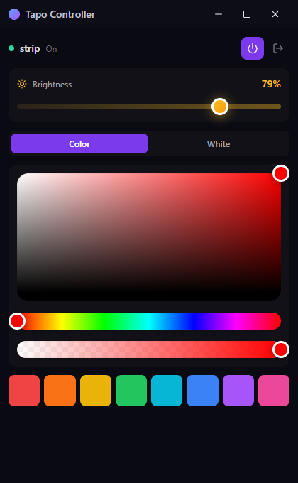

# Tapo Controller

<p align="center">
  
</p>

<p align="center">
  <strong>A modern desktop app for controlling TP-Link Tapo LED strips</strong>
</p>

<p align="center">
  <a href="https://github.com/BartaG512/tapo-controller/releases/latest"></a>
  <a href="LICENSE"></a>
  
  
</p>

<p align="center">
  <a href="#features">Features</a> &middot;
  <a href="#installation">Installation</a> &middot;
  <a href="#usage">Usage</a> &middot;
  <a href="#supported-devices">Supported Devices</a> &middot;
  <a href="#development">Development</a>
</p>

---

## Features

- **Color Control** - Full HSV color picker with real-time preview
- **Brightness** - Smooth brightness adjustment (1-100%)
- **White Temperature** - Warm to cool white (2500K-6500K)
- **Quick Colors** - 8 preset colors for instant access
- **Custom Presets** - Save and apply your favorite color/brightness combinations
- **Multi-Device** - Manage multiple Tapo LED strips from one app
- **Device Discovery** - Scan your local network to find Tapo devices
- **Scheduling** - Automate your lights with time-based schedules
- **Power Control** - Turn on/off with one click
- **Auto-reconnect** - Remembers your devices and reconnects on startup
- **Secure Credentials** - Passwords stored in your OS keychain, not in plain text
- **System Tray** - Runs in background with quick controls (power, brightness)
- **Auto-start** - Optionally launch on system startup
- **Dark Theme** - Modern dark UI with violet accents

## Supported Devices

| Model | Color | Brightness | Temperature | Effects |
|-------|:-----:|:----------:|:-----------:|:-------:|
| L900  |  Yes  |    Yes     |     Yes     |   No    |
| L920  |  Yes  |    Yes     |     Yes     |   Yes   |
| L930  |  Yes  |    Yes     |     Yes     |   Yes   |

Other Tapo light devices may also work but are untested.

## Installation

### Download

Grab the latest release for your platform from the [Releases page](https://github.com/BartaG512/tapo-controller/releases/latest):

| Platform | File |
|----------|------|
| Windows  | `Tapo-Controller-Setup.exe` |
| macOS    | `Tapo-Controller.dmg` |
| Linux    | `Tapo-Controller.AppImage` |

### Build from Source

**Prerequisites:** [Node.js 18+](https://nodejs.org/), [Rust](https://rustup.rs/), [Tauri v2 prerequisites](https://v2.tauri.app/start/prerequisites/)

```bash
git clone https://github.com/BartaG512/tapo-controller.git
cd tapo-controller

# Install frontend dependencies
npm install

# Run in development mode (starts both Vite dev server and Tauri)
npm run dev

# Or build a release binary for your platform
npm run build
```

## Usage

1. **Find your device IP** - Open the Tapo mobile app, select your LED strip, go to Settings > Device Info to find the IP address.
2. **Connect** - Launch Tapo Controller, enter your Tapo account email, password, and the device IP.
3. **Control** - Adjust colors, brightness, and white temperature using the interactive controls.

You can also use **Device Discovery** to scan your local network instead of entering the IP manually.

### Quick Tips

- **System tray**: Close the window to minimize to tray. Right-click the tray icon for quick power and brightness controls.
- **Presets**: Save a color/brightness combination you like, then apply it with one click.
- **Schedules**: Set your lights to turn on/off at specific times automatically.
- **Multiple devices**: Add more devices from the device list. The app remembers all of them.

## Tech Stack

| Layer    | Technology |
|----------|------------|
| Frontend | React 19, TypeScript, Tailwind CSS, Vite |
| Desktop  | Tauri v2 |
| Backend  | Rust (tokio, serde, keyring) |
| Device API | [tapo](https://github.com/mihai-dinculescu/tapo) crate |
| Icons    | Lucide React |

## Development

### Architecture

```
tapo-controller/
├── src/                   # React frontend (TypeScript)
│   ├── App.tsx            # Main application component
│   ├── components/        # UI components (TitleBar, etc.)
│   └── styles/            # Tailwind CSS styles
├── src-tauri/             # Tauri + Rust backend
│   ├── src/
│   │   ├── lib.rs         # App setup, tray, auto-reconnect
│   │   ├── commands.rs    # Tauri command handlers (IPC API)
│   │   ├── device.rs      # Tapo device abstraction (L900/L920/L930)
│   │   ├── storage.rs     # JSON persistence (devices, presets, schedules)
│   │   ├── scheduler.rs   # Cron-based schedule execution
│   │   ├── discovery.rs   # Local network device scanning
│   │   └── credentials.rs # OS keychain integration
│   └── tauri.conf.json    # Tauri app configuration
├── docs/                  # Screenshots
└── package.json           # Frontend dependencies & scripts
```

### Scripts

```bash
npm run dev          # Start Tauri dev mode (Vite + Rust with hot reload)
npm run build        # Build release binary for current platform
npm run dev:vite     # Start only the Vite frontend dev server
npm run build:frontend  # Build only the frontend
```

## Credits

- [tapo](https://github.com/mihai-dinculescu/tapo) - Unofficial TP-Link Tapo API client for Rust
- [react-colorful](https://github.com/omgovich/react-colorful) - Lightweight color picker component
- [Tauri](https://v2.tauri.app/) - Desktop application framework

## License

MIT License - see [LICENSE](LICENSE) for details.
